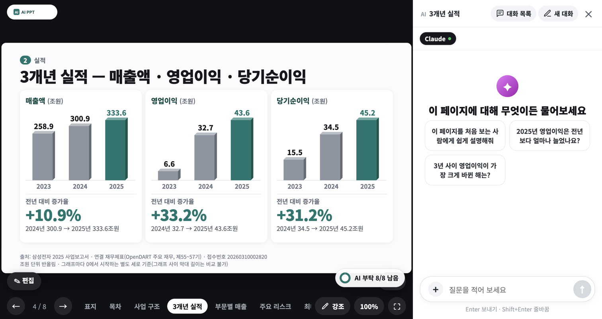
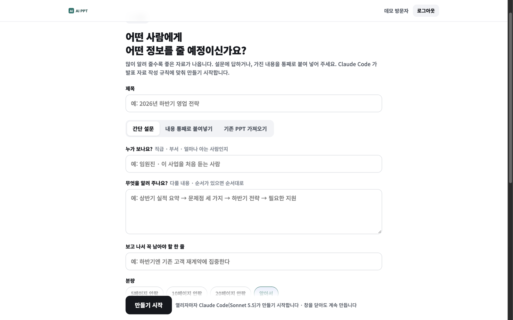

<h1 align="center">DART Deck</h1>

<p align="center"><b>말로 만들고 말로 고치는 발표 자료</b><br>
누구에게 무엇을 알려 줄지 적으면 Claude Code 에이전트가 한국 발표 자료 규칙에 맞춰 덱을 만들고, 페이지마다 대화로 고칩니다.</p>

<p align="center">


</p>

<p align="center"></p>

## 주요 기능

- **대화로 만드는 덱** - 간단 설문, 내용 통째로 붙여넣기, 그림 · 문서(pdf · pptx · docx) 첨부 중 하나로 시작하면 Claude Code 가 바로 첫 판을 씁니다.
- **페이지마다 묻고 고치기** - 한 페이지 수정은 바로, 여러 페이지 · 새 페이지는 계획을 보여 준 뒤 [진행]. 고친 뒤 화면을 찍어 스스로 확인하고, 사람이 [적용] 해야 반영됩니다(이전과 비교 · 되돌리기).
- **한국 발표 자료 규칙** - 제목 · 본문 크기, 한 장 한 메시지, 출처 각주 같은 규칙(`engine/DECK.md`)을 에이전트가 지키고, 화면 점검(DeckCheck)이 넘침 · 겹침을 잡습니다.
- **직접 편집** - 끌어 옮기기 · 크기 · 글꼴 · 도형 · 그림, 페이지 추가 · 복제 · 삭제.
- **가져오기 · 내보내기** - 기존 PPT · PDF 를 쪽마다 원본 모양 그대로 가져오고, 완성본은 편집 가능한 PPTX · PDF 로 내보냅니다.
- **DART 공시 RAG(선택)** - 유가증권시장 대형사 사업보고서를 BM25 + bge-m3 로 찾아, 숫자마다 공시 접수번호를 각주로 단 회사 분석 덱을 만듭니다(MCP 도구).
- **계정 · 데모** - 계정마다 덱 저장, 관리자 전체 열람, 데모 방문자용 횟수 제한.

## 스크린샷

| 덱 보기 + AI 대화 | 새 발표 자료 |
|---|---|
|  |  |

## 빠른 시작

```bash
git clone https://github.com/Nelef/dart-deck.git && cd dart-deck
npm install && npx playwright install chromium
npm i -g @anthropic-ai/claude-code       # 덱 작성 · 수정은 Claude Code CLI(claude -p)로 돕니다
python3 server/app.py                     # -> http://localhost:8900 (처음 계정 admin / admin, 바로 바꾸세요)
```

로그인한 뒤 계정 설정에서 `claude setup-token` 으로 받은 내 토큰을 연결하면 바로 쓸 수 있습니다.

**Docker** - `docker build -t dart-deck . && docker compose up -d` (데이터는 `./data` - 계정 · 세션 · 덱, 커밋하지 않음). PPTX 변환용 LibreOffice 와 한글 글꼴이 이미지에 들어갑니다.

## AI 연동

이 저장소에는 어떤 계정 · 토큰도 들어 있지 않습니다. 쓰는 사람이 각자 연결합니다.

| 방법 | 설정 | 비고 |
|---|---|---|
| 내 Claude 계정 연결(기본) | 웹 화면 계정 설정에서 `claude setup-token` 으로 받은 토큰을 연결 | 계정마다 따로 저장, 그 사람의 사용량으로 돈다 |
| 운영자 공용 토큰(선택) | `DECK_SHARED_TOKEN` · `DECK_SHARED_TOKEN_2` | 데모 방문자용. 횟수 상한 `DECK_DEMO_RUNS` · `DECK_DEMO_DAILY` |
| 다른 모델로 이어 쓰기(선택) | `ALT_LLM_KEY` + LiteLLM(`server/litellm.example.yaml`), `GEMINI_API_KEY` | Claude Code 틀은 그대로, 모델만 바꾼다 |
| 로컬 LLM(선택) | `DECK_LLM_BASE` · `DECK_ASK_URL` | vLLM 같은 OpenAI 호환 서버 |
| DART RAG(선택) | `DART_API_KEY`(OpenDART 인증키) -> `python3 rag/fetch.py` · `node rag/embed.mjs` | 색인은 메모리 또는 Qdrant(`DART_QDRANT`) |

여러 사람에게 공개 서비스로 운영한다면 개인 구독 대신 각 제공사의 API 이용 조건에 맞는 방식으로 연결하세요.

## 프로젝트 구조

| 폴더 | 무엇 |
|---|---|
| `server/` | Python 표준 http.server 기반 서버 - 계정 · 덱 저장(`store.py`), Claude Code 에이전트 실행(`deckagent.py`), PPTX 변환(`pptx_build.py` · `lo_convert.py`), 가져오기(`importer.py`), 대체 엔진(`alt_llm.py`) |
| `engine/` | 덱 엔진(HTML · CSS · JS) - 페이지 틀, 편집기, 화면 점검(DeckCheck), PDF · PPTX · 썸네일 도구, 한국 발표 자료 규칙(`DECK.md`) |
| `rag/` | DART 공시 수집 · 파싱 · 임베딩 · 검색 · 평가 · MCP 서버 |
| `web/` | 첫 화면 · 덱 목록 · 개인 포털 화면 |

## 라이선스

[MIT](LICENSE). `engine/fonts/` 의 Noto Sans KR · Noto Sans Symbols · JetBrains Mono 는 SIL Open Font License 1.1, DART 공시 데이터는 OpenDART 이용 조건을 따릅니다(데이터는 저장소에 없고 `rag/fetch.py` 로 직접 받습니다).
